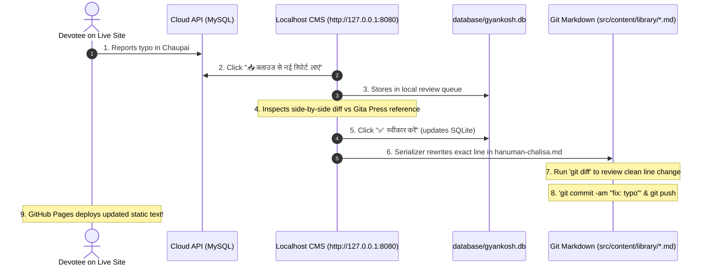

# 🕉️ Gyankosh Hybrid Architecture & Local Setup Guide

This guide explains how to run Gyankosh locally, start the Localhost CMS, and configure the API endpoints for both local development and production deployment.

---

## 🏛️ System Architecture Summary

1. **Public E-Reader (Edge)**: 100% static Astro site hosted for free on GitHub Pages.
2. **Local CMS Workspace (Localhost)**: Fast PHP & SQLite desktop environment running on FrankenPHP (`http://127.0.0.1:8080`) to inspect verses, track physical Gita Press verification, and review typo reports.
3. **Cloud API (PHP & MySQL)**: Lightweight, public REST backend (`cloud-api/`) for crowdsourced typo submissions and privacy-first anonymous reading analytics.

---

## 🚀 1. How to Run Locally

### Prerequisites
* **Node.js**: `v22.12.0+`
* **FrankenPHP / PHP**: `8.1+` with `pdo_sqlite` extension (installed on your system).

### Step 1: Install Dependencies
```bash
npm install
```

### Step 2: Initialize / Ingest SQLite Database
Ingest all 108 Git Markdown files into the local SQLite database (`database/gyankosh.db`):
```bash
npm run db:ingest
```
> *Note: `database/gyankosh.db` is strictly local and ignored by Git.*

### Step 3: Start the Local CMS Workspace
Launch the Local CMS dashboard:
```bash
npm run cms
```
Now open your browser at:
👉 **[http://127.0.0.1:8080](http://127.0.0.1:8080)**

### Step 4: Start the Astro Static Site (Reader Preview)
In a separate terminal, launch the Astro development server:
```bash
npm run dev
```
Now open your browser at:
👉 **[http://localhost:4321/gyankosh/](http://localhost:4321/gyankosh/)**

---

## ⚙️ 2. API Endpoint & Environment Configuration

### A. Astro Frontend Configuration (`.env`)
To connect the live reader with the Cloud API for typo reporting and analytics, create or update a `.env` file in the project root:

```env
# URL where your cloud-api is hosted
PUBLIC_API_URL=https://api.ashishvishwakarma.com
```

* **Local testing**: If running the cloud API locally on port 8000:
  ```env
  PUBLIC_API_URL=http://127.0.0.1:8000
  ```
* **Offline / No API**: If `PUBLIC_API_URL` is omitted, the reader functions normally in offline fallback mode (storing typo submissions in the user's browser `localStorage`).

---

### B. Cloud API Configuration (`cloud-api/config.php`)
The Cloud API handles anonymous analytics and collects typo reports into MySQL.

Edit [`cloud-api/config.php`](cloud-api/config.php) or supply environment variables:

| Variable | Default Value | Description |
| :--- | :--- | :--- |
| `DB_HOST` | `127.0.0.1` | MySQL Host |
| `DB_PORT` | `3306` | MySQL Port |
| `DB_NAME` | `gyankosh_cloud` | Database Name (created via `cloud-api/database/schema_cloud.sql`) |
| `DB_USER` | `root` | Database Username |
| `DB_PASS` | `""` | Database Password |
| `ADMIN_API_KEY` | `gyankosh_secret_admin_key_2026` | **Secret key** required for Local CMS to pull pending reports |

#### CORS Whitelist:
By default, [`cloud-api/config.php`](cloud-api/config.php) permits requests from:
* `https://www.ashishvishwakarma.com`
* `https://ashv.github.io`
* `http://localhost:4321` and `http://127.0.0.1:4321` (Astro dev)
* `http://localhost:8080` and `http://127.0.0.1:8080` (Local CMS)

---

### C. Local CMS Cloud Sync Configuration (`tools/cms/config.php`)
Controls where the Localhost CMS pulls pending typo submissions from when you click **"📥 क्लाउड से नई रिपोर्ट लाएं"**.

Edit [`tools/cms/config.php`](tools/cms/config.php):
```php
return [
    // URL of your deployed Cloud API
    'cloud_api_url' => getenv('GYANKOSH_CLOUD_API_URL') ?: 'https://api.ashishvishwakarma.com',

    // Must match ADMIN_API_KEY set in cloud-api/config.php
    'admin_api_key' => getenv('GYANKOSH_ADMIN_KEY') ?: 'gyankosh_secret_admin_key_2026',
];
```

---

## 🧪 3. Testing Cloud API Locally (Optional)

If you want to test the entire Cloud API loop locally on your machine before uploading it to a public server:

1. **Create MySQL database**:
   ```sql
   mysql -u root -p < cloud-api/database/schema_cloud.sql
   ```
2. **Start the Cloud API server on port 8000**:
   ```bash
   frankenphp php-server --listen 127.0.0.1:8000 --root cloud-api
   ```
3. **Point Local CMS to local Cloud API** in [`tools/cms/config.php`](tools/cms/config.php):
   ```php
   'cloud_api_url' => 'http://127.0.0.1:8000',
   ```

---

## 🔄 4. The Daily Git & Verification Workflow



---

## 📋 Handy NPM Script Reference

| Command | Action |
| :--- | :--- |
| `npm run cms` | Launches the Localhost CMS on `http://127.0.0.1:8080`. |
| `npm run dev` | Launches the Astro static website on `http://localhost:4321/gyankosh/`. |
| `npm run db:ingest` | Hydrates local SQLite database from Git Markdown files. |
| `npm run db:export` | Serializes local SQLite database into Git Markdown files. |
| `npm run db:check` | Runs round-trip integrity check (verifies 108/108 files produce 0 diff). |
| `npm run build` | Builds production static bundle for GitHub Pages. |
